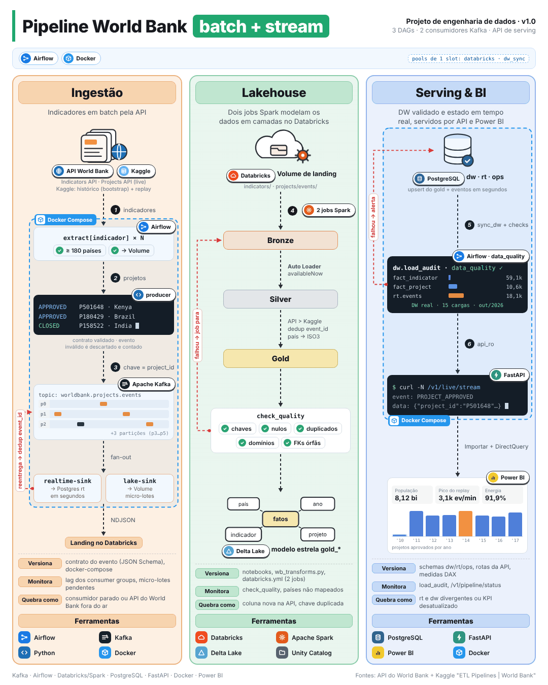
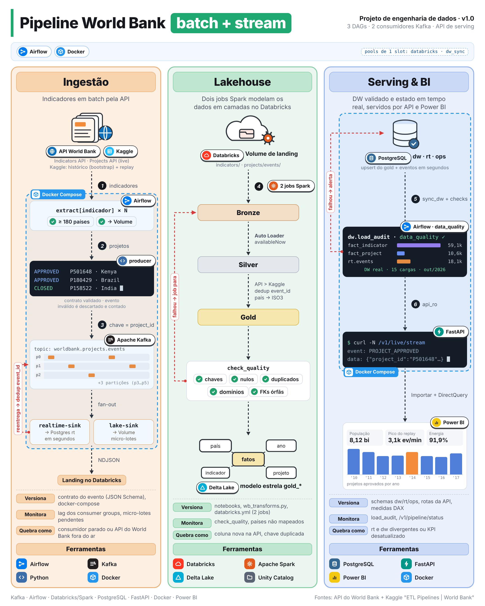
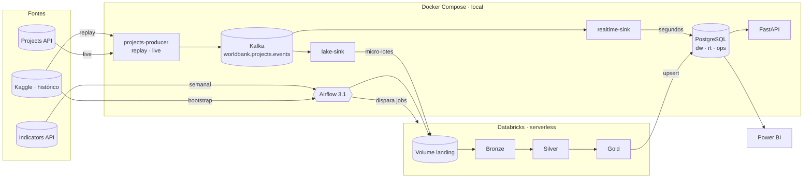

<h1 align="center">World Bank Data Platform</h1>

<p align="center">
  <strong>Plataforma de dados batch + streaming sobre dados públicos do Banco Mundial</strong><br>
  Airflow · Kafka · Databricks (Spark/Delta) · PostgreSQL · FastAPI · Power BI · Docker
</p>

<p align="center">
  <a href="https://github.com/RenanWRodrigues/worldbank-data-platform/actions/workflows/ci.yml"></a>
  
  
  
  
  
  
  
  
  
  
</p>

<p align="center">
  <a href="https://app.powerbi.com/view?r=eyJrIjoiZGUzYmYwZWUtNjI4OS00MGM0LWI4MjEtYjIzNmNiM2ExNTgwIiwidCI6Ijk5MjYwYzhkLWRlMGMtNGQ4OS1iZjAxLWEyMTJkOTgzNmVkOSJ9"></a> <!-- gitleaks:allow (link público do "Publicar na Web") -->
</p>

<p align="center">
  
</p>

<p align="center">
  <sub>
    <a href="docs/img/infografico.png">Imagem estática em alta resolução (PNG)</a> ·
    <a href="docs/img/infografico_animado.mp4">Vídeo (MP4)</a> ·
    <a href="docs/img/infografico_animado.html">Fonte editável (HTML)</a>
  </sub>
</p>

---

## Visão geral

Os dados do Banco Mundial chegam em **duas velocidades**, e a plataforma trata cada uma com a ferramenta certa:

- **Indicadores de desenvolvimento** (população, PIB, população rural, acesso à eletricidade) são séries anuais
  revisadas poucas vezes por ano → **batch semanal** orquestrado pelo Airflow, com checagem de cobertura.
- **Projetos de financiamento** são aprovados, alterados e encerrados ao longo do ano → **stream de eventos** no
  Kafka com dois consumidores: um entrega o estado **em segundos**, o outro alimenta o lakehouse para análise
  **modelada e consistente** no DW.

Os dois fluxos convergem no mesmo data warehouse, numa API de serving e num relatório Power BI. A operação local
roda inteira em Docker; o lakehouse roda no Databricks (Free Edition, serverless).

**Fontes:** [Indicators API e Projects API](https://datahelpdesk.worldbank.org/knowledgebase/topics/125589) do
Banco Mundial e o dataset do Kaggle
[`nilaychauhan/world-bank-datasets`](https://www.kaggle.com/datasets/nilaychauhan/world-bank-datasets) como
histórico e fonte do modo *replay*.

### Destaques

| | |
|---|---|
| **2 velocidades, 1 modelo** | Batch semanal e stream de eventos chegando ao mesmo esquema estrela |
| **Exatamente uma vez no efeito** | Entrega at-least-once com `event_id` determinístico e deduplicação em todo consumidor |
| **Qualidade que bloqueia** | Checagens no Spark, na extração e no DW interrompem o pipeline em vez de publicar dado ruim |
| **Custo sob controle** | Databricks serverless só liga com arquivo novo ou na carga semanal (short-circuit) |
| **Testável sem nuvem** | ~97% de cobertura com fakes de HTTP, Kafka e banco; Spark local com ANSI ligado |

## Sumário

- [Arquitetura](#arquitetura)
- [Stack e decisões](#stack-e-decisões)
- [Garantias de engenharia](#garantias-de-engenharia)
- [Como executar](#como-executar)
- [API de serving](#api-de-serving)
- [Dashboard](#dashboard)
- [Resultados](#resultados)
- [Qualidade e testes](#qualidade-e-testes)
- [Estrutura do repositório](#estrutura-do-repositório)
- [Documentação](#documentação)

## Arquitetura

<p align="center">
  <a href="docs/img/infografico.png">
    
  </a>
</p>

O infográfico mostra as três etapas da plataforma, numeradas de 1 a 6 na ordem do fluxo:

| Etapa | O que acontece | Ferramentas |
|---|---|---|
| **Ingestão** | (1) Airflow extrai cada indicador (≥ 180 países) para o Volume; (2) o producer publica eventos de projeto validados pelo contrato; (3) o Kafka particiona por `project_id`; os dois sinks consomem em paralelo | Airflow · Python · Kafka · Docker |
| **Lakehouse** | (4) Dois jobs Spark leem a landing com Auto Loader e modelam bronze → silver (API > Kaggle, dedup por `event_id`, país → ISO3) → gold em estrela; `check_quality` falha o job | Databricks · Spark · Delta Lake · Unity Catalog |
| **Serving & BI** | (5) `sync_dw` copia o gold para o PostgreSQL com auditoria e checagens; (6) a FastAPI lê `dw` e `rt` com usuário somente leitura; o Power BI usa Importar + DirectQuery | PostgreSQL · FastAPI · Power BI · Docker |

O mesmo desenho, em diagrama:



| Fluxo | Caminho | Latência |
|---|---|---|
| **Indicadores** (batch) | Airflow → Indicators API → Volume do Databricks → job `worldbank_indicators` (bronze → silver → gold) → upsert no PostgreSQL `dw` → checagens de qualidade | semanal |
| **Projetos — tempo real** | `projects-producer` → Kafka → `realtime-sink` → PostgreSQL `rt` → API (SSE) e Power BI (DirectQuery) | segundos |
| **Projetos — analítico** | Kafka → `lake-sink` (micro-lotes NDJSON) → Volume → job `worldbank_projects` → `dw` | até 30 min |

- O **producer** opera em dois modos: *replay* do histórico do Kaggle com relógio acelerado, ou *live*, consultando
  a Projects API e publicando apenas o que mudou (diff por hash contra `ops.producer_state`).
- O **Airflow** orquestra três DAGs: `worldbank_indicators_weekly`, `worldbank_projects_microbatch` (a cada 30 min)
  e `worldbank_bootstrap_kaggle` (manual).
- O **serving** é feito por uma FastAPI que lê `dw` e `rt` com usuário somente leitura, e por um relatório Power BI
  em modelo composto (`dw` importado, `rt` em DirectQuery).

### Modelo de dados

| Camada | Onde | Conteúdo |
|---|---|---|
| **Bronze** | Delta (Databricks) | Linhas NDJSON da landing como chegaram, com arquivo de origem e hora de ingestão |
| **Silver** | Delta (Databricks) | Indicadores por país × indicador × ano (API > Kaggle), países, eventos deduplicados por `event_id` e estado atual de cada projeto |
| **Gold / `dw`** | Delta → PostgreSQL | Estrela com `dim_country`, `dim_indicator`, `dim_year`, `fact_indicator`, `fact_project` e `agg_country_year`, além de `load_audit` e da view `vw_country_year` |
| **`rt`** | PostgreSQL | `project_events` (log idempotente), `projects_latest` (estado atual) e `alerts` (grandes aprovações) |
| **`ops`** | PostgreSQL | Controle da landing, estado do producer e histórico de lag do Kafka |

Especificação completa em [`docs/modelo-de-dados.md`](docs/modelo-de-dados.md).

## Stack e decisões

O volume é modesto (~59 mil linhas de indicadores, ~10,6 mil projetos, ~18 mil eventos). As ferramentas foram
escolhidas pelos **padrões de engenharia** que demonstram, e cada uma resolve um problema concreto do desenho:

| Componente | Papel na plataforma | Limite nesta escala |
|---|---|---|
| **Apache Kafka 3.9** (KRaft) | Um stream, **dois consumer groups** com velocidades diferentes; retenção de 30 dias para reprocessamento e replay | Com um único consumidor, uma fila no Postgres bastaria |
| **Databricks serverless** · Spark 3.5 · Delta | Arquitetura medalhão com Auto Loader, deduplicação e prioridade de fonte (API > Kaggle); serverless só liga com dado novo | Os dados cabem em memória; o valor está no padrão lakehouse |
| **Apache Airflow 3.1** | Orquestra etapas heterogêneas (API, Volume, job remoto, sync, qualidade) com retries, mapeamento dinâmico e short-circuit | Duas agendas fixas caberiam em cron, até a primeira falha parcial |
| **PostgreSQL 16.6** | DW em estrela (`dw`), estado em tempo real (`rt`) e controle operacional (`ops`), com usuários somente leitura | Um DW colunar só se justificaria com volume muito maior |
| **FastAPI 0.115** · Pydantic 2.14 · Uvicorn 0.34 | Camada de serving: perfis, séries, rankings, projetos e eventos ao vivo via SSE, sem expor o banco; modelos de resposta validados pelo Pydantic e servidos pelo Uvicorn | — |
| **Power BI** | Modelo composto: histórico importado + página "Ao vivo" em DirectQuery (só no Desktop, local) | — |
| **Docker Compose** | Toda a operação local com `make up` em uma máquina de 8 GB | Recursos apertados: cada serviço tem `mem_limit` |

### Versões

Todas as versões são fixadas; a imagem de cada serviço e os testes locais usam as mesmas.

| Ferramenta | Versão | Onde está fixada |
|---|---|---|
| Python | 3.12.12 (imagens) · 3.12 (local) | `api/Dockerfile`, `ingestion/Dockerfile` |
| Apache Airflow | 3.1.8 (`apache/airflow:3.1.8-python3.12`) | `airflow/Dockerfile` |
| Providers do Airflow | databricks 7.10.0 · postgres 6.6.0 · standard 1.12.0 · fab 3.4.0 | `airflow/requirements.txt` |
| Apache Kafka | 3.9.1 (`apache/kafka`, modo KRaft) | `docker-compose.yml` |
| Kafka UI | v0.7.2 (`provectuslabs/kafka-ui`) | `docker-compose.yml` |
| confluent-kafka | 2.13.2 | `ingestion/requirements.txt`, `airflow/requirements.txt` |
| PostgreSQL | 16.6 | `docker-compose.yml` |
| psycopg2-binary | 2.9.10 | `api/requirements.txt`, `ingestion/requirements.txt` |
| Databricks | serverless (runtime gerenciado), Asset Bundle | `databricks/databricks.yml` |
| PySpark (testes locais) | 3.5.3, com Java 17 ou 21 | `requirements-dev.txt` |
| databricks-sql-connector | 4.2.5 | `airflow/requirements.txt` |
| pycountry | 24.6.1 | `requirements-dev.txt` e `%pip install` dos notebooks |
| FastAPI | 0.115.6 (sobre Starlette 0.41.3, que vem com ele) | `api/requirements.txt`, `requirements-dev.txt` |
| Pydantic | 2.14.1 | `api/requirements.txt` |
| Uvicorn | 0.34.0 | `api/requirements.txt` |
| pytest · ruff · pre-commit | 8.3.4 · 0.17.3 · 4.0.1 | `requirements-dev.txt` |

As decisões estão registradas como ADRs em [`docs/adr/`](docs/adr/).

## Garantias de engenharia

- **At-least-once com idempotência** — `event_id` determinístico (UUIDv5 de projeto + tipo + hash do conteúdo).
  Reentregas, replays repetidos e retries não duplicam dados em `rt` nem no silver. O offset do Kafka só é
  confirmado depois da persistência (arquivo na landing + `ops.landing_files`, ou a transação em `rt`).
- **Ordenação por projeto** — chave Kafka = `project_id`. O estado atual nunca regride: a comparação usa
  `(autoridade da fonte, event_time, produced_at)` — evento da Projects API vence o do replay do Kaggle
  ([ADR 0009](docs/adr/0009-fonte-api-vence-replay-no-estado-do-projeto.md)) —, só eventos gravados pela primeira
  vez disputam o estado, e um encerramento nunca fica antes do último evento do projeto
  ([ADR 0008](docs/adr/0008-ordem-dos-eventos-de-encerramento-e-reentregas.md)).
- **DW transacional** — carga gold → `dw` numa única transação (COPY + `INSERT … ON CONFLICT` apenas para linhas
  alteradas), espelho dos fatos com proteção contra origem vazia e trilha de auditoria em `dw.load_audit`. Arquivos
  da landing só são marcados como processados após o sync.
- **Qualidade que interrompe o pipeline** — `check_quality` no Spark (PK, NOT NULL, domínios, FKs órfãs),
  `coverage_check` na extração (≥ 180 países por indicador) e `data_quality` no DW (faixas, frescor, lag do Kafka
  e consistência `rt` × `dw` em até 60 minutos).
- **Custo controlado** — o Databricks só é acionado na carga semanal ou quando há arquivo novo; pools de 1 slot
  impedem dois jobs escrevendo o gold, ou dois syncs escrevendo o DW, ao mesmo tempo.
- **Segurança** — segredos apenas em `.env` (gitleaks no pre-commit e no CI), usuários de leitura dedicados para
  BI e API, API key opcional e portas publicadas somente em `127.0.0.1`.

## Como executar

### Pré-requisitos

- Docker Desktop (≥ 4 GB de memória para o WSL no Windows; 8 GB livres para a stack completa)
- Python 3.12 e Java 17 ou 21 (testes Spark)
- Conta no Kaggle e no Databricks (Free Edition)
- [Databricks CLI](https://docs.databricks.com/dev-tools/cli/) autenticado

### Passo a passo

```bash
make setup           # dependências de desenvolvimento e pre-commit
make env             # cria o .env a partir do .env.example (preencha Databricks, senhas e AIRFLOW_JWT_SECRET)
make data            # baixa o dataset do Kaggle para data/raw
databricks auth login --host https://<seu-workspace>
make bundle-deploy   # publica notebooks e os 2 jobs; registre os job_id em DATABRICKS_JOB_ID_* no .env
make up              # Postgres, Kafka, producer, sinks, Airflow (:8080) e API (:8000)
```

No Airflow (<http://localhost:8080>), execute `worldbank_bootstrap_kaggle` (histórico) e
`worldbank_indicators_weekly` (API), e ative `worldbank_projects_microbatch`. O replay do Kaggle inicia com o
`make up`; `make live` troca o producer para a Projects API.

```bash
make api-demo        # status do pipeline, projetos ao vivo e ranking de PIB
make stream          # eventos chegando em tempo real (SSE)
make help            # todos os comandos disponíveis
```

> **Sem Databricks?** `make up-stream` sobe apenas o fluxo de projetos (Postgres, Kafka, producer, sinks e API),
> sem o Airflow — ideal para ver o stream funcionando em poucos minutos.

| Serviço | Endereço |
|---|---|
| API (Swagger) | <http://localhost:8000/docs> |
| Airflow | <http://localhost:8080> |
| Kafka UI | <http://localhost:8085> |
| PostgreSQL | `localhost:5432` |

Problemas comuns de ambiente (memória do WSL, token expirado, DAG em `deferred`) e como conferir a versão de cada
serviço estão no [runbook](docs/runbook.md).

## API de serving

Documentação interativa em <http://localhost:8000/docs>. Com `API_KEY` definido, as rotas `/v1` exigem o header
`X-API-Key`.

| Rota | Origem | Descrição |
|---|---|---|
| `GET /v1/countries` · `/v1/countries/{iso3}` | `dw` | Países, filtros por região e renda, perfil com último ano disponível |
| `GET /v1/countries/{iso3}/indicators` | `dw` | Séries históricas por indicador |
| `GET /v1/indicators` · `/v1/rankings/{código}` | `dw` | Catálogo e ranking de países (sem agregados) |
| `GET /v1/projects` · `/v1/projects/{id}` | `dw` + `rt` | Projetos paginados; detalhe com estado ao vivo e histórico de eventos |
| `GET /v1/live/projects` · `/v1/live/alerts` | `rt` | Estado em tempo real e alertas de grandes aprovações |
| `GET /v1/live/stream` | `rt` | Server-Sent Events, com retomada por `Last-Event-ID` |
| `GET /v1/pipeline/status` | `rt` + `ops` + `dw` | Lag do Kafka, landing pendente e últimas cargas |

```bash
curl -s "localhost:8000/v1/rankings/NY.GDP.MKTP.CD?top=3"
# {"indicator_code":"NY.GDP.MKTP.CD","year":2025,"items":[{"rank":1,"country_code":"USA","value":3.08e13}, …]}

curl -N "localhost:8000/v1/live/stream?backfill=5"
# event: PROJECT_APPROVED
# data: {"project_id":"P501648", …}
```

Sem `?year=`, o ranking usa o ano mais recente com pelo menos 180 países, evitando anos com cobertura parcial.

## Dashboard

Relatório Power BI em modelo composto (`dw` em Importar, `rt` em DirectQuery) com uma página inicial de navegação
e cinco páginas de análise:

| Página | Conteúdo |
|---|---|
| **Visão Global** | População, PIB, PIB per capita e eletricidade; evolução desde 1990, top 10 por PIB e PIB per capita por região |
| **Energia e Desenvolvimento** | Acesso à eletricidade × população rural, evolução 2000 → hoje por região e países com maior déficit |
| **Projetos do Banco Mundial** | Aprovações e valor comprometido por ano, região, setor, instrumento e país |
| **Perfil do País** | Drill-through com séries históricas, posição no ranking de PIB e projetos por setor |
| **Ao vivo** *(só local)* | DirectQuery sobre `rt`: eventos por minuto, últimos projetos e alertas, com atualização a cada 30 s |

**Versão publicada (Power BI Service):** [**abrir o dashboard**](https://app.powerbi.com/view?r=eyJrIjoiZGUzYmYwZWUtNjI4OS00MGM0LWI4MjEtYjIzNmNiM2ExNTgwIiwidCI6Ijk5MjYwYzhkLWRlMGMtNGQ4OS1iZjAxLWEyMTJkOTgzNmVkOSJ9) (link público, sem login). Traz só as
quatro primeiras páginas, uma foto dos dados importados do
`dw`. A página **Ao vivo** fica oculta e sem botão na página inicial. Ela consulta em DirectQuery o PostgreSQL da
stack Docker (`localhost`), que o serviço na nuvem não alcança. Para vê-la, abra
`powerbi/relatorio/WorldBank.pbip` no Power BI Desktop com a stack de pé (`make up-stream`). O tempo real também
aparece sem o Power BI, pela API: `make stream` (SSE em `/v1/live/stream`).

Medidas em [`powerbi/medidas.dax`](powerbi/medidas.dax), tema em
[`powerbi/tema_worldbank.json`](powerbi/tema_worldbank.json), montagem passo a passo em
[`powerbi/GUIA_POWERBI.md`](powerbi/GUIA_POWERBI.md) e conferência dos números em
[`powerbi/validacao_kpis.sql`](powerbi/validacao_kpis.sql).

## Resultados

Números extraídos do DW com dados reais. Ano de referência **2024**: o último em que os quatro indicadores cobrem
pelo menos 180 países (em 2025 ainda falta o acesso à eletricidade).

| Métrica | Valor |
|---|---|
| População mundial (217 países) | **8,12 bilhões** · +1,03% ao ano entre 2014 e 2024 |
| PIB mundial | **US$ 110,6 trilhões** · +4,0% sobre 2023 |
| Acesso à eletricidade | **91,9%** · 655 milhões de pessoas ainda sem acesso |
| Projetos aprovados (2000–2017) | **8.430 projetos · US$ 589 bilhões** · média de US$ 107 milhões |

- A **África Subsaariana** passou de **25,3% (2000) para 55,1% (2024)** de acesso à eletricidade e concentra o
  déficit: Nigéria (87 milhões) e RD Congo (85 milhões) lideram.
- As aprovações de projetos atingiram o pico em **2009**, na resposta à crise financeira. **Índia (US$ 57 bi)** e
  **Brasil (US$ 32,8 bi)** foram os maiores destinos.
- **Brasil, 2024:** 212 milhões de habitantes, PIB de **US$ 2,19 trilhões** (11º do mundo), US$ 10,3 mil per
  capita, **99,8% de acesso à eletricidade** e 12,1% de população rural.

> O Kaggle cobre aprovações até junho de 2018 e a API em modo live traz apenas projetos ativos; por isso os totais
> de projetos posteriores a 2017 não são comparáveis com a série histórica.

## Qualidade e testes

| Camada | Escopo | Comando |
|---|---|---|
| Unitários | Fakes de HTTP, Kafka e banco; sem rede | `make test` |
| Spark | Transformações com ANSI ligado, como no serverless | `make test-spark` |
| Integridade das DAGs | Importação e configuração das DAGs no container do Airflow | `make test-airflow` |
| Integração | Contra a stack Docker em execução | `make test-integration` |
| Cobertura | Unitários + Spark (mínimo de 80%, atual ~97%) | `make coverage` |

O CI ([`.github/workflows/ci.yml`](.github/workflows/ci.yml)) executa lint (ruff), testes unitários, testes Spark
com cobertura mínima, pre-commit com gitleaks e validação do `docker-compose.yml`.

## Estrutura do repositório

```
.
├── ingestion/          cliente das APIs, loader do Kaggle, producer de eventos, lake-sink e realtime-sink
├── databricks/         Asset Bundle (2 jobs serverless), notebooks e transformações (src/wb_transforms.py)
├── airflow/            DAGs e include/ (extração, sync gold → dw, lag do Kafka, controle da landing, qualidade)
├── api/                FastAPI de serving (repositório injetável, testes sem banco)
├── postgres/init/      schemas ops, rt e dw, view analítica e usuários somente leitura
├── powerbi/            medidas DAX, tema, guia do relatório e SQL de validação dos KPIs
├── docs/               arquitetura, modelo de dados, contratos, ADRs, runbook e imagens (docs/img/)
├── tests/              testes transversais, fixtures da API, amostra sintética e integração
├── .github/workflows/  pipeline de CI
├── docker-compose.yml
├── Makefile
└── pyproject.toml
```

## Documentação

| Documento | Conteúdo |
|---|---|
| [`docs/arquitetura.md`](docs/arquitetura.md) | Componentes, fontes, DAGs e requisitos não funcionais |
| [`docs/modelo-de-dados.md`](docs/modelo-de-dados.md) | Tabelas `ops`, `rt`, lakehouse e `dw`, carga gold → dw e regras de qualidade |
| [`docs/contratos/evento-kafka.schema.json`](docs/contratos/evento-kafka.schema.json) | JSON Schema do evento do tópico `worldbank.projects.events`, validado pelo producer e pelos consumidores |
| [`docs/contratos/registros-normalizados.md`](docs/contratos/registros-normalizados.md) | Formato dos registros de indicadores, países e projetos depois da normalização das APIs |
| [`docs/adr/`](docs/adr/) | Decisões de arquitetura (landing em Volume, gold no Postgres, Airflow 3, duas velocidades, FastAPI, fontes, semântica dos eventos, ordem do encerramento e reentregas, API vence o replay no estado do projeto) |
| [`docs/runbook.md`](docs/runbook.md) | Incidentes reais do projeto, como resolvê-los e como conferir as versões |
| [`docs/img/`](docs/img/) | Infográfico do pipeline (PNG, GIF, MP4 e fonte HTML editável) |
| [`CHANGELOG.md`](CHANGELOG.md) | Histórico de versões |

---

<p align="center">
  Desenvolvido por <strong>Renan Rodrigues</strong> ·
  <a href="https://github.com/RenanWRodrigues">GitHub</a>
</p>
