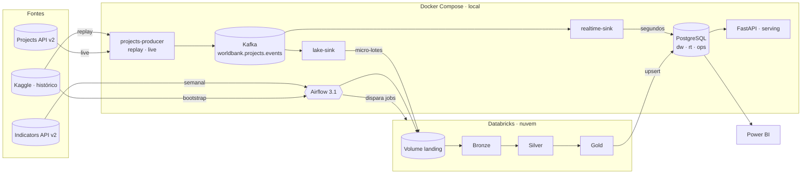

# Arquitetura (v2)

Dois fluxos com velocidades diferentes, porque os dados têm naturezas diferentes:

- **Indicadores** (população, PIB, % rural, % eletricidade): séries anuais revisadas poucas vezes por ano
  → **batch semanal** orquestrado pelo Airflow.
- **Projetos do Banco Mundial**: aprovados, alterados e encerrados ao longo do ano
  → **stream de eventos** no Kafka com **dois consumidores** (lakehouse e tempo real).

## Fontes

| Fonte                                                      | Uso                                                                                             | Observações                                                                                                                            |
| ---------------------------------------------------------- | ----------------------------------------------------------------------------------------------- | -------------------------------------------------------------------------------------------------------------------------------------- |
| **Indicators API v2** `api.worldbank.org/v2`               | extração semanal de cada indicador (`/country/all/indicator/{código}`) e metadados (`/country`) | resposta `[metadados, linhas]`, paginação `page/pages`; país em `countryiso3code`; agregados têm `region.value == "Aggregates"`        |
| **Projects API v2** `search.worldbank.org/api/v2/projects` | modo _live_ do producer                                                                         | paginação `os/rows`; filtros `strdate/enddate`; `projects` pode vir como objeto `{id: projeto}` ou lista                               |
| **Kaggle** `nilaychauhan/world-bank-datasets`              | (1) bootstrap do histórico de indicadores; (2) modo _replay_ do producer                        | CSV WDI com 4 linhas de metadados; população em CSV/JSON/XML/SQLite; `projects_data.csv` com valores "6,060,000" e `countryname` "X;X" |

Toda resposta é **normalizada** em `ingestion/worldbank_client.py` para os formatos de
`docs/contratos/registros-normalizados.md`; nada a jusante depende do JSON cru.

## Componentes

### 1. Cliente das APIs — `ingestion/worldbank_client.py`

Paginação, retries com backoff (429/5xx), parsing e normalização em **funções puras** (`requests==2.32.3`,
`defusedxml==0.7.1` para o XML do Kaggle).
Indicators API sempre com `per_page=1000` (o padrão de 50 daria ~340 páginas por indicador).

### 2. Producer de eventos — `ingestion/projects_producer.py` (serviço contínuo)

Semântica completa dos eventos nas ADRs 0007 e 0008.

- `replay`: lê o Kaggle, gera `PROJECT_APPROVED` na data de aprovação (status Active) e `PROJECT_CLOSED`
  na data de encerramento, em ordem cronológica, com relógio acelerado (`REPLAY_DAYS_PER_SECOND`).
  Projetos **sem** `boardapprovaldate` (Pipeline/Dropped) são ignorados; `CLOSED` só é gerado se
  `closing_date ≤ hoje`; o replay termina em "hoje" (nada de evento no futuro).
- `replay` termina com código 0 e o serviço fica parado (`restart: on-failure`); `make replay`/`make live` o recriam.
- `live`: a cada `POLL_MINUTES` consulta a Projects API — todos os projetos **Active** ∪ aprovados nos últimos
  `LIVE_LOOKBACK_DAYS` ∪ os que estavam Active no estado e sumiram dessas listas (rebuscados por `id`, é assim
  que um encerramento é detectado) —, só com os campos usados (`fl`), compara o hash de cada projeto com
  `ops.producer_state` e publica só o que mudou: novo com status Active/Closed → APPROVED (e CLOSED em seguida
  se já encerrado); status Closed que antes não era → CLOSED; outra mudança → UPDATED. Projetos em
  **Pipeline** não geram evento até serem aprovados (o estado é guardado para o diff). O mesmo vale para projetos
  Active **sem** `boardapprovaldate` na API (em out/2026, 464 de 2 666 — em geral "Additional Financing"): ficam em
  `ops.producer_state` e só entram no stream quando a data aparecer; a diferença para o total da API não é perda.
- `event_time`: data do fato quando existe (aprovação para APPROVED, encerramento para CLOSED, meia-noite UTC);
  hora da detecção para UPDATED. O CLOSED nunca fica antes do último evento do projeto (ADR 0008): preso na
  aprovação e, depois de um UPDATED, na hora da detecção. `produced_at` é sempre a hora da publicação.
- Falha da Projects API no live (rede ou API fora, depois dos retries do cliente) pula o ciclo com um aviso no
  log, sem publicar nem salvar estado; falha do Kafka encerra o processo (`restart: on-failure`).
- Producer idempotente (`acks=all`), chave = `project_id`, contrato em `docs/contratos/evento-kafka.schema.json`.

### 3. Kafka 3.9.1 — KRaft (interno `kafka:9092`, host `localhost:9094`)

Imagem `apache/kafka:3.9.1`; clientes com `confluent-kafka==2.13.2` (producer, sinks e `kafka_lag` do Airflow).
Tópico `worldbank.projects.events`: 6 partições, retenção de 30 dias. Kafka UI (`provectuslabs/kafka-ui:v0.7.2`)
em `:8085`.

### 4. Consumidor `lake-sink` — `ingestion/lake_sink.py`

Fecha micro-lotes NDJSON (`FLUSH_MAX_EVENTS` ou `FLUSH_MAX_SECONDS`) — cada linha é o evento do contrato mais
`kafka_partition` e `kafka_offset`, último desempate da ordem no silver —, grava na landing
(`projects/events/date=.../part-<offsets>-<uuid>.json`), registra em `ops.landing_files` e só então
faz commit do offset (at-least-once).

### 5. Consumidor `realtime-sink` — `ingestion/realtime_sink.py`

Aplica cada lote em `rt.project_events` (idempotente por `event_id`), `rt.projects_latest`
(upsert que nunca regride: compara `(autoridade da fonte, event_time, produced_at)` — a Projects API vence o replay, ADR 0009; só eventos inseridos agora em `rt.project_events`
disputam o estado — reentregas, mesmo com `produced_at` novo, não reaplicam) e `rt.alerts`
(aprovação ≥ `ALERT_MIN_COMMITMENT_USD`). Roda com **uma única instância**: o SSE ordena por `rt.project_events.seq`,
e escritores concorrentes poderiam tornar `seq` visível fora de ordem.

### 6. Databricks — `databricks/` (Asset Bundle, serverless, trigger `availableNow`)

Runtime serverless gerenciado pela Databricks (sem versão fixada no bundle); os testes locais das transformações
usam `pyspark==3.5.3` com Java 17 ou 21 e ANSI ligado, como no serverless.

- Job **`worldbank_indicators`**: `00_setup → 10_indicators → 30_serving`
- Job **`worldbank_projects`**: `00_setup → 20_projects → 30_serving`
- Dependências Python (`pycountry==24.6.1`) instaladas com `%pip install` na 1ª célula de cada notebook — o
  serverless não as traz, e `environments`/`environment_key` do bundle só valem para tarefas Python script/wheel/dbt.
- Parâmetros dos jobs: `catalog`, `schema`, `volume`, `run_id` e `job` (define o que o `check_quality` exige).
- Silver: prioridade API > Kaggle; dedup de eventos por `event_id`; estado atual do projeto = último evento, com a Projects API acima do replay (ADR 0009);
  país por ISO2 (metadados da API, só se não for agregado) e, em segundo lugar, por nome (overrides +
  `pycountry.lookup` exato).
- Gold: tabelas de `docs/modelo-de-dados.md` com prefixo `gold_`; `30_serving` reconstrói `dim_year` e
  `agg_country_year` de todo o silver; `check_quality` falha o job (não vazia só para o que o job produz).

### 7. Airflow 3.1.8 — `airflow/` (`:8080`)

Imagem `apache/airflow:3.1.8-python3.12` com os providers `databricks==7.10.0`, `postgres==6.6.0`,
`standard==1.12.0` e `fab==3.4.0`, mais `databricks-sql-connector==4.2.5` (`airflow/requirements.txt`).

| DAG                             | Agenda         | Tarefas                                                                                                                                                       |
| ------------------------------- | -------------- | ------------------------------------------------------------------------------------------------------------------------------------------------------------- |
| `worldbank_indicators_weekly`   | `10 6 * * 1`   | `indicator_list` → `extract` (mapeamento dinâmico) + `countries` → `coverage_check` → `databricks_indicators` → `sync_dw` → `mark_processed` → `data_quality` |
| `worldbank_projects_microbatch` | `*/30 * * * *` | `kafka_lag` → `has_new_files` (short-circuit) → `databricks_projects` → `sync_dw` → `mark_processed` → `data_quality`                                         |
| `worldbank_bootstrap_kaggle`    | manual         | `load_kaggle_history` (Kaggle + `/country`) → `databricks_indicators` → `sync_dw` → `mark_processed`                                                          |

Pools `databricks` e `dw_sync` com 1 slot cada: os dois jobs nunca escrevem o gold ao mesmo tempo, e dois `sync_dw`
nunca espelham o mesmo fato do dw em paralelo. As extrações do Airflow gravam
sempre no Volume (host e token da conexão `databricks_default`); `mark_processed` marca só os arquivos da execução e roda depois do `sync_dw` (falha no sync deixa os arquivos
pendentes e a próxima execução refaz job e sync).
As tabelas que cada `sync_dw` copia estão em `docs/modelo-de-dados.md` (Carga gold → dw).

### 8. PostgreSQL 16.6 (`:5432`)

Imagem `postgres:16.6`; clientes Python com `psycopg2-binary==2.9.10`.

Schemas `ops` (controle), `rt` (tempo real) e `dw` (estrela). Usuários somente leitura `powerbi` (dw, rt) e
`api_ro` (dw, rt, `ops.landing_files`, `ops.kafka_lag`), criados por `postgres/init/00_users.sh` com as senhas
`POWERBI_PASSWORD` e `API_RO_PASSWORD` do `.env` — nenhuma senha em SQL versionado.

### 9. FastAPI 0.115.6 — `api/` (`:8000`) — camada de serving

`fastapi==0.115.6` (Starlette 0.41.3), `pydantic==2.14.1` e `uvicorn==0.34.0` sobre `python:3.12.12-slim`.

Lê `dw` e `rt` com `api_ro`. Rotas `/v1/countries…`, `/v1/indicators`, `/v1/rankings/{código}`,
`/v1/projects…`, `/v1/live/projects`, `/v1/live/alerts`, `/v1/live/stream` (SSE) e `/v1/pipeline/status`.
API key opcional (`X-API-Key`). Repositório injetável: testes sem banco.

### 10. Power BI Desktop

`dw` em Importar + `rt` em DirectQuery (modelo composto); página inicial de navegação + 5 páginas, incluindo
"Ao vivo". Publicado no Power BI Service, o relatório mostra só as 4 páginas importadas: "Ao vivo" fica oculta
(o serviço não alcança o Postgres local em DirectQuery; detalhes em `powerbi/GUIA_POWERBI.md`, seção 12).

## Requisitos não funcionais

- **Idempotência:** `event_id` determinístico (uuid5 de projeto + tipo + hash do conteúdo); reentregas e
  replays não duplicam em `rt` nem no silver; reexecutar DAG/job/sync é seguro.
- **Ordem:** por projeto (chave Kafka); `rt.projects_latest` ignora eventos mais antigos que o estado atual
  (desempate por `produced_at`).
- **Consistência do DW:** upsert em transação única + `dw.load_audit`.
- **Custo:** o Databricks só liga quando há dados novos (short-circuit) ou na carga semanal.
- **Segurança:** segredos só no `.env`; usuários de leitura para BI e API; API key opcional; portas publicadas só
  em `127.0.0.1` (o Kafka UI não tem autenticação).
- **Portabilidade:** toda a parte local sobe com `make up` (8 GB livres). Com 8 GB a stack fica apertada:
  cada serviço tem `mem_limit` no compose, o Kafka roda com `KAFKA_HEAP_OPTS=-Xmx512m -Xms512m`, e
  `make up-stream` sobe só o fluxo de projetos (Postgres, Kafka, producer, sinks e API) sem o Airflow.
